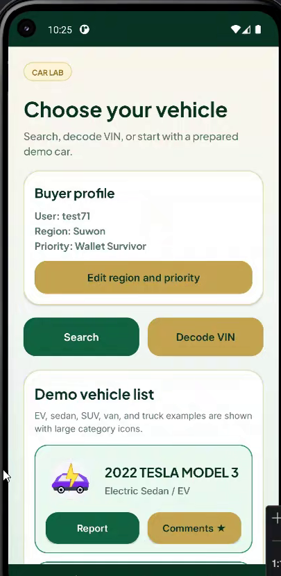
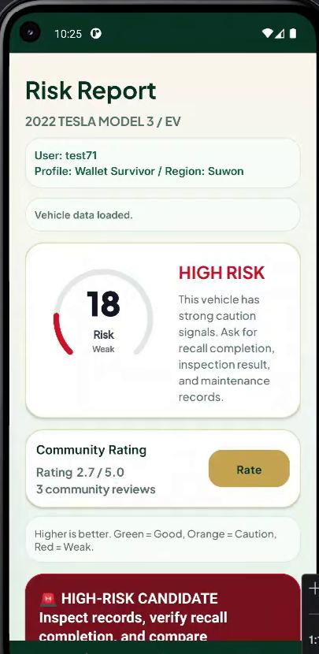
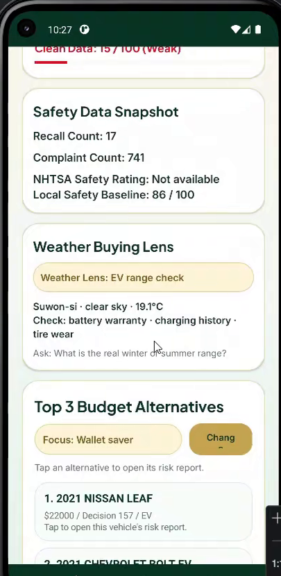
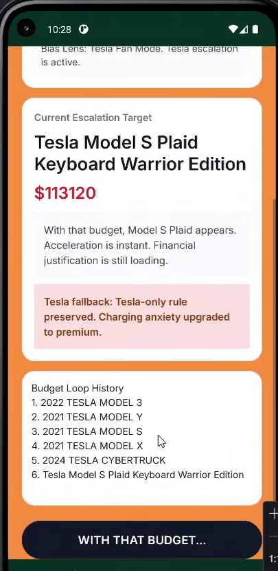

<div align="center">

# CarCheck Lab

중고차를 사기 전에 리콜·결함 신고·안전 정보와 내 구매 성향을 한 화면에 모아 보여 주는 Android 앱


</div>

## 소개

중고차 정보는 가격, 주행거리, VIN, 리콜, 결함 신고, 날씨처럼 흩어져 있어서 다 보고도 무엇을 해야 할지 모르기 쉽습니다. CarCheck Lab은 이것들을 Risk Report 하나로 묶고, 딜러를 만나기 전에 무엇을 확인할지 알려 줍니다. 점수는 정답이 아니라 1차 판단용 안내이고, 전문 점검을 대신하지 않습니다.

<p align="center">
  
  
  
  
</p>

## 주요 기능

| 기능 | 내용 |
| --- | --- |
| Risk Report | 위험 점수와 등급, 최종 판단, 커뮤니티 평점, 점수 요약(Wallet, Budget Defense, 하차감, Practicality, Clean Data), 리콜·결함 신고 수, 안전 등급을 요약부터 보여 줍니다. |
| 차량 찾기 | 데모 차량, 브랜드·모델 검색, 17자리 VIN 디코딩 중 어디서 시작해도 같은 보고서로 이어집니다. |
| 구매자 프로필 | 도시와 구매 성향(Safety Nerd, Wallet Survivor 등)에 따라 같은 차도 다르게 해석합니다. 프로필은 서버에 저장됩니다. |
| 빈 데이터 처리 | 공공 API가 `Not Rated`나 빈 값을 주면 0점으로 치지 않고 기준 데이터로 보충한 뒤, 기준값을 썼다는 사실을 화면에 밝힙니다. |
| 차종 구분 | 전기차(EV, BEV)와 하이브리드(HEV, PHEV)를 따로 구분해 아이콘, 날씨 조언, EV 후보 필터에 반영합니다. |
| Weather Buying Lens | 내 도시의 현재 날씨를 시승 때 확인할 점 하나로 바꿔 줍니다(비, 더위, 냉간 시동, EV 주행거리 등). |
| 리뷰와 평점 | 계정마다 차량당 리뷰 하나만 쓸 수 있어 평균이 한 사람에게 쏠리지 않습니다. 수정과 삭제가 됩니다. |
| 딜러 코치 | 리콜 조치, 정비 이력, 가격, 배터리 상태처럼 판매자에게 물어볼 질문을 보여 줍니다. |
| 예산 대안 Top 3 | 최저가, 지갑 방어, 안전 근거, 국산만, EV 후보 등 기준을 바꿔 대안을 다시 고릅니다. |
| Budget Black Hole | "그 돈이면 이거 사지"로 예산이 계속 올라가는 심리를 풍자한 기능입니다. |

## 기술 구성

| 구분 | 사용 기술 |
| --- | --- |
| 앱 | Kotlin, Android(minSdk 29, targetSdk 36), XML 레이아웃 |
| 네트워크 | OkHttp, Gson, Kotlin 코루틴 |
| 공공 API | NHTSA 리콜·결함 신고·안전 등급, NHTSA vPIC VIN 디코딩, OpenWeather |
| 서버 | AWS API Gateway, Lambda(Python), DynamoDB |
| 로컬 데이터 | `market_cars.txt`(차량별 기준 가격과 점수), SharedPreferences |

## 설치 전 준비

1. [Android Studio](https://developer.android.com/studio)를 설치합니다.
2. 날씨 기능을 쓰려면 [OpenWeather](https://openweathermap.org/api)에서 API 키를 받습니다. 없어도 앱은 돌아가고 날씨 카드만 기본 안내로 바뀝니다.
3. 로그인과 프로필 저장을 쓰려면 `server/README_server.md`대로 DynamoDB 테이블(`CarCheckUsers`, 파티션 키 `userId`), Lambda(`server/lambda_function.py`), API Gateway를 만듭니다.

NHTSA API는 키가 필요 없습니다.

## 설치

```bash
git clone https://github.com/aniseongu/carcheck-lab.git
```

1. `app/src/main/java/edu/skku/map/carchecklab/WeatherClient.kt`의 `OPENWEATHER_API_KEY`에 받은 키를 넣습니다.
2. `ServerAuthClient.kt`의 `AUTH_API_URL`을 내 API Gateway 주소로 바꿉니다.
3. Android Studio에서 **File > Open**으로 저장소 폴더를 엽니다. Gradle 동기화가 끝나면 에뮬레이터나 기기를 골라 실행합니다.

## 사용법

1. 계정을 만들고 로그인합니다.
2. 도시와 구매 성향을 고릅니다. 나중에 차량 목록 화면에서 바꿀 수 있습니다.
3. 데모 차량을 고르거나, 브랜드·모델로 검색하거나, VIN을 입력합니다.
4. Risk Report에서 점수와 판단을 보고, 결함 상세, 리뷰, 딜러 코치, 예산 대안으로 넘어갑니다.

## 주의

- 로그인 서버는 시연용입니다. 비밀번호를 해시하지 않고 저장하므로 실제 서비스에 그대로 쓰면 안 됩니다.
- 리뷰와 저장한 보고서는 기기 안에만 남습니다.
- 공식 제조사 로고는 쓰지 않고 차종별 아이콘을 씁니다. 글꼴은 Plus Jakarta Sans와 Inter(SIL Open Font License)입니다.
